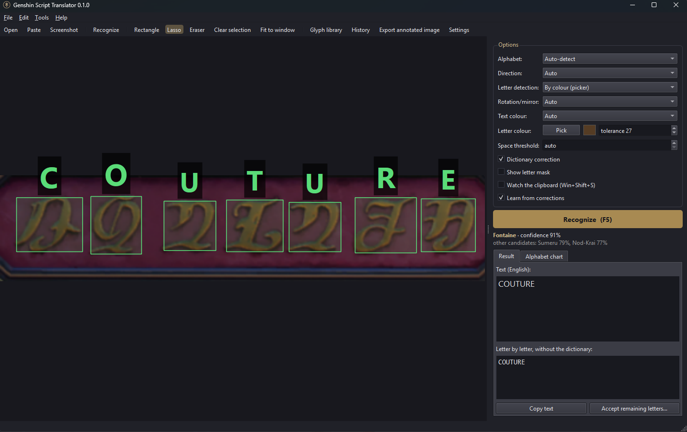

# Genshin Script Translator

[](https://github.com/JustKirill1/genshin-script-translator/actions/workflows/ci.yml)
[](https://github.com/JustKirill1/genshin-script-translator/releases)
[](LICENSE)


**English** · [Русский](#русский)

A desktop app that reads the in-game scripts of Teyvat from Genshin Impact screenshots and turns
them into English text. Every Teyvat script is a letter-for-letter cipher of English, so the app
recognizes each glyph, maps it to its Latin letter and fixes the words with an English dictionary.


## Features

- **7 scripts**, detected automatically: Teyvat Common (Mondstadt, Liyue), Inazuma, Sumeru,
  Desert (Deshret), Fontaine, the ancient Teyvat script and Nod-Krai.
- **Screenshot in, text out**: paste from the clipboard (`Win+Shift+S`, then `Ctrl+V`, or let the
  app watch the clipboard), open a file, drop it on the window, or take a screenshot (`F9`).
- **Free-form selection**: rectangle, lasso, and an eraser (`Alt`) to cut out sign frames and noise.
- **Signs seen from behind**: upside-down and mirrored inscriptions are detected automatically.
- **Learns from you**: click a letter to correct it — the glyph is saved to your library and
  recognized next time. "Accept remaining letters" confirms the rest in one go.
- **Noise removal**: remove a false "letter", or learn it as noise so similar specks are ignored.
- **Shareable glyph library**: view, relabel and delete samples; export/import `.gsrlib` files to
  share with other players.
- **Dictionary correction** that splits run-together words (`SMITHSHOP` → `SMITH SHOP`) and only
  touches doubtful letters; unknown names are left alone.
- **History** of recognized inscriptions with the picture and the selection, **annotated image
  export**, vertical text for Inazuma, English and Russian interface.

## Examples

| Mondstadt (Teyvat Common) | Fontaine |
|---|---|
|  |  |

**Inazuma, Sumeru, Deshret, Nod-Krai, ancient script — screenshots wanted!** These scripts are only
tested on synthetic images so far. If you have screenshots of inscriptions, please
[open an issue](https://github.com/JustKirill1/genshin-script-translator/issues) or a pull request
(name them `docs/images/example-<region>.png`).

## Download and run

**Windows, no Python needed:** download `GenshinScriptTranslator-<version>-windows.zip` from
[Releases](https://github.com/JustKirill1/genshin-script-translator/releases), unzip and run
`GenshinScriptTranslator.exe`.

**From source** (Windows, Linux, macOS; Python 3.10+):

```bash
git clone https://github.com/JustKirill1/genshin-script-translator.git
cd genshin-script-translator
pip install -r requirements.txt
python main.py
```

On Windows you can simply double-click `run.bat`: the first start creates a virtual environment and
installs the dependencies. `run_console.bat` shows errors in a console.

Your learned glyphs, history and settings are stored in `%APPDATA%\GenshinScriptTranslator`
(`~/.local/share/GenshinScriptTranslator` on Linux/macOS). For a **portable** setup (e.g. on a USB
stick) create an empty file `portable.txt` next to the program — data will be kept in `userdata/`
beside it.

## How to use

1. **Get the inscription into the app.** The fastest way: in the game press `Win+Shift+S`, cut out
   the inscription and press `Ctrl+V` in the app. With *Watch the clipboard* enabled you don't even
   need to paste.
2. **Select the text** if the picture contains more than the inscription:
   `R` rectangle, `L` lasso; hold `Alt` (or toggle *Eraser*) to subtract — e.g. cut away the frame
   of a sign. `Shift` adds another area. Recognition starts automatically.
3. **Read the result.** Every glyph gets a box with its letter: green — confident, yellow —
   doubtful, red — poor, blue — confirmed by you. The text panel shows the dictionary-corrected
   English (corrected words in green) and the raw letter-by-letter reading.
4. **Correct and teach.** Click a glyph:

   

   - pick another letter or type one — the glyph is saved to your library (*Learn from corrections*);
   - *"X" is right — save as a sample* confirms a correct letter;
   - *Remove (not a letter)* drops noise from the text; *Remove and learn as noise* also teaches the
     app to ignore similar marks.

   **Accept remaining letters** (`Ctrl+Enter`) shows all letters you haven't confirmed yet; uncheck
   the wrong ones (low-confidence letters are red) and learn the rest at once.

The game font differs a little from the alphabet charts, so ten or twenty corrections noticeably
improve recognition of a script.

### Glyph library


*Tools → Glyph library* (`Ctrl+L`) lists all samples per script with their source — **built-in**
(shipped with the app), **mine** (learned on this computer) or **imported** (with the author's
nickname) — next to the chart reference. You can change a sample's letter, delete it (built-in
samples are only hidden and can be restored) and filter by letter or source.

### Sharing libraries with other players

*Export…* saves your samples to a `.gsrlib` file (choose the scripts, whether to include built-in
and noise samples, and your nickname). *Import…* merges someone else's file into your library;
duplicates are skipped. To share a library with everyone, send it via a pull request to the
[`community/`](community/) folder.

### Other tools

- **History** (`Ctrl+H`): every recognized inscription with a thumbnail; click one to bring back the
  picture and the selection.
- **Export annotated image** (`Ctrl+E`): the inscription with boxes, letters and the decoded text —
  handy for sharing. Saved to `docs/images` when running from the repository, otherwise to Pictures.
- **Letter detection** options: *Auto* tries Otsu threshold, background flattening (for dim and
  embossed text) and adaptive threshold in both polarities. *By colour*: press *Pick* and click a
  letter — the best mode for text on busy backgrounds.
- **Direction**: Inazuma texts can be vertical (columns right to left).
- **Settings** (`Ctrl+,`): language, export folder, defaults, history size, data folder.
- Command line: `python cli.py screenshot.png [--alphabet fontaine] [--region x0 y0 x1 y1] [--export out.png]`

## Accuracy

- Synthetic inscriptions made from chart glyphs (all 7 scripts, text height 18–48 px, noise, blur,
  JPEG): **≈1.6 % character error rate, 91 % of phrases exactly right, script detected in 100 %**.
- Real screenshots (`tests/real`, 6 inscriptions from Mondstadt and Fontaine, each also mirrored and
  upside down — 18 cases): script and orientation detected correctly in every case, **≈3 % character
  error rate** both without learned samples and in a leave-one-out test.

The real-screenshot set is small and covers only two scripts, so expect lower accuracy on other
places until more samples are collected.

## Known limitations

- **Text and background of similar colours** (low contrast) are hard to separate — letters break
  apart or merge with the background. Try *By colour* with the picker, or *Flatten background*.
- **Shimmering text, or text lit differently in different parts** (glow, gradients, embossed signs
  catching light) may be detected only partly. *Flatten background* helps; the lasso can exclude the
  worst parts.
- **Very small text** (below ~18 px letter height) loses details; zoom in the game or take the
  screenshot at a higher resolution.
- **Text at an angle or in perspective** (signs on walls seen from the side) is not straightened.
- **The in-game font differs from the fan-made charts** in places — teach the app with corrections.
- Only Teyvat Common and Fontaine have been tested on real screenshots so far.
- The dictionary does not understand meaning: it may pick `NOTE AT` instead of `NOT EAT`, and it
  occasionally splits unknown names.
- The Nod-Krai chart has no signs for J, Q and X; two signs of the ancient script are undeciphered.
- Touching letters are cut automatically, but strongly overlapping ones may be read as one.
- *Screenshot* (`F9`) may capture a black image when the game runs in exclusive fullscreen — use
  borderless windowed mode or `Win+Shift+S`.

## How it works

1. **Binarization** of the selected area in several ways (Otsu, morphological background
   flattening, adaptive threshold) and both polarities; small text is upscaled first.
2. **Components** are found, the glyph size is estimated, touching glyphs are cut at narrow points.
3. Components are grouped into **lines** (or columns for vertical text).
4. Inside a line a **dynamic program** decides which components form one glyph (letters made of
   strokes and dots), scoring candidates with a nearest-neighbour classifier over augmented
   templates (chart glyphs plus learned samples; HOG and pixel features).
5. Every script, mask variant and rotation/mirror is tried; readings are ranked by glyph
   similarity, dictionary hits and sanity priors; the best one is corrected with a dictionary
   line decoder.

## Development

```bash
pip install -r requirements-dev.txt
pytest                                   # engine tests + offscreen GUI smoke test
python tools/benchmark.py                # synthetic accuracy benchmark
python tools/real_eval.py                # real screenshots, leave-one-out
python tools/visualize.py tests/real/fontaine3.png out.png binarize=flat
build.bat                                # Windows .exe into dist/
```

Pushing a tag `v*` builds the Windows release on GitHub Actions.

```
genshin_script_translator/   engine (recognizer, features, lexicon, library, selection, history…)
  gui/                       PySide6 interface
  i18n/                      UI translations (en.json, ru.json)
alphabets/                   alphabet charts
data/                        word lists and the built-in glyph library
community/                   glyph libraries shared by players
tests/  tools/  packaging/   tests, developer tools, PyInstaller spec
```

**Adding a language:** copy `genshin_script_translator/i18n/en.json` to `<code>.json`, translate the
values and set `"_language_name"`; it appears in Settings. `pytest` checks that no key is missing.

## Credits and license

- Code: [MIT License](LICENSE) © 2026 JustKirill1.
- Alphabet charts in `alphabets/`: [Genshin Impact Wiki (Fandom), "Language"](https://genshin-impact.fandom.com/wiki/Language),
  licensed [CC BY-SA 3.0](https://creativecommons.org/licenses/by-sa/3.0/). See [alphabets/README.md](alphabets/README.md).
- English word list `data/words_en.txt`: [google-10000-english](https://github.com/first20hours/google-10000-english)
  by Josh Kaufman, derived from the Google Web Trillion Word Corpus; permitted for educational,
  personal and research use (not for commercial use).
- Genshin Impact and its scripts are property of HoYoverse. This is an unofficial fan project and is
  not affiliated with or endorsed by HoYoverse.

---

<a id="русский"></a>

# Genshin Script Translator (русский)

[English](#genshin-script-translator) · **Русский**

Десктопное приложение, которое читает письменности Тейвата на скриншотах Genshin Impact и
превращает их в английский текст. Все письменности Тейвата — побуквенный шифр английского, поэтому
программа распознаёт каждый знак, сопоставляет его латинской букве и исправляет слова по
английскому словарю.


## Возможности

- **7 письменностей**, определяются автоматически: общий язык Тейвата (Мондштадт, Ли Юэ),
  Инадзума, Сумеру, Пустыня (Дешрет), Фонтейн, древнетейватское письмо и Нод-Край.
- **Скриншот на входе — текст на выходе**: вставка из буфера (`Win+Shift+S`, затем `Ctrl+V`, или
  программа сама следит за буфером), открытие файла, перетаскивание в окно, снимок экрана (`F9`).
- **Выделение произвольной формы**: прямоугольник, лассо и ластик (`Alt`), чтобы вырезать рамки
  вывесок и шум.
- **Вывески с обратной стороны**: перевёрнутые и зеркальные надписи определяются автоматически.
- **Учится у тебя**: клик по букве — исправить, знак сохраняется в библиотеку и в следующий раз
  узнаётся. «Принять оставшиеся буквы» подтверждает остальные за раз.
- **Удаление шума**: убрать ложную «букву» или запомнить её как шум, чтобы похожие пятна игнорировались.
- **Библиотека букв, которой можно делиться**: просмотр, смена буквы, удаление образцов;
  экспорт и импорт файлов `.gsrlib` для обмена с другими игроками.
- **Словарная коррекция**: разбивает слипшиеся слова (`SMITHSHOP` → `SMITH SHOP`) и меняет только
  сомнительные буквы; незнакомые имена не трогает.
- **История** распознанных надписей с картинкой и выделением, **экспорт картинки с разметкой**,
  вертикальный текст Инадзумы, интерфейс на английском и русском.

## Примеры

| Мондштадт (общий язык Тейвата) | Фонтейн |
|---|---|
|  |  |

**Инадзума, Сумеру, Дешрет, Нод-Край, древнее письмо — нужны скриншоты!** Пока эти письменности
проверены только на синтетических картинках. Если у тебя есть скриншоты надписей,
[создай issue](https://github.com/JustKirill1/genshin-script-translator/issues) или pull request
(имена файлов `docs/images/example-<регион>.png`).

## Скачать и запустить

**Windows, Python не нужен:** скачай `GenshinScriptTranslator-<версия>-windows.zip` в
[Releases](https://github.com/JustKirill1/genshin-script-translator/releases), распакуй и запусти
`GenshinScriptTranslator.exe`.

**Из исходников** (Windows, Linux, macOS; Python 3.10+):

```bash
git clone https://github.com/JustKirill1/genshin-script-translator.git
cd genshin-script-translator
pip install -r requirements.txt
python main.py
```

На Windows можно просто запустить `run.bat`: при первом запуске он создаст виртуальное окружение и
поставит зависимости. `run_console.bat` показывает ошибки в консоли.

Выученные буквы, история и настройки хранятся в `%APPDATA%\GenshinScriptTranslator`
(`~/.local/share/GenshinScriptTranslator` на Linux/macOS). **Портативный режим** (например, на
флешке): создай пустой файл `portable.txt` рядом с программой — данные будут храниться в папке
`userdata/` рядом с ней.

## Как пользоваться

1. **Передай надпись в программу.** Быстрее всего: в игре нажми `Win+Shift+S`, вырежи надпись и
   нажми `Ctrl+V` в программе. С включённым «Следить за буфером обмена» вставлять не нужно.
2. **Выдели текст**, если на картинке есть что-то кроме надписи: `R` — прямоугольник,
   `L` — лассо; держи `Alt` (или включи «Ластик»), чтобы вычесть область — например, срезать рамку
   вывески. `Shift` добавляет ещё одну область. Распознавание запускается само.
3. **Прочитай результат.** У каждого знака рамка с буквой: зелёная — уверенно, жёлтая — сомнительно,
   красная — плохо, синяя — подтверждена тобой. В панели справа — английский текст после словаря
   (исправленные слова зелёным) и сырое побуквенное прочтение.
4. **Исправляй и обучай.** Клик по знаку:

   

   - выбери другую букву или введи свою — знак сохранится в библиотеку («Запоминать исправления»);
   - «"X" верно — запомнить образец» подтверждает правильную букву;
   - «Убрать (это не буква)» выкидывает шум из текста; «Убрать и запомнить как шум» вдобавок учит
     программу игнорировать похожие пятна.

   **Принять оставшиеся буквы** (`Ctrl+Enter`) показывает все ещё не подтверждённые буквы: сними
   галочки с неправильных (неуверенные выделены красным) и выучи остальные разом.

Игровой шрифт немного отличается от таблиц алфавитов, поэтому десяток-другой исправлений заметно
улучшает распознавание письменности.

### Библиотека букв


«Инструменты → Библиотека букв» (`Ctrl+L`) показывает все образцы по письменностям с источником —
**встроенный** (идёт с программой), **мой** (выучен на этом компьютере) или **импорт** (с ником
автора) — рядом с эталоном из таблицы. Образцу можно сменить букву, удалить его (встроенные только
скрываются, их можно вернуть), фильтровать по букве и источнику.

### Обмен библиотеками с другими игроками

«Экспорт…» сохраняет твои образцы в файл `.gsrlib` (выбери письменности, включать ли встроенные
образцы и шум, укажи ник). «Импорт…» добавляет чужой файл в твою библиотеку, дубликаты
пропускаются. Чтобы поделиться библиотекой со всеми, пришли её через pull request в папку
[`community/`](community/).

### Другие инструменты

- **История** (`Ctrl+H`): все распознанные надписи с превью; клик возвращает картинку и выделение.
- **Экспорт картинки с разметкой** (`Ctrl+E`): надпись с рамками, буквами и расшифровкой — удобно
  делиться. Сохраняется в `docs/images` при запуске из репозитория, иначе в «Изображения».
- **Выделение букв**: «Авто» перебирает порог Оцу, выравнивание фона (для тусклых и рельефных
  надписей) и адаптивный порог в обе полярности. «По цвету»: нажми «Пипетка» и кликни по букве —
  лучший режим для текста на пёстром фоне.
- **Направление**: тексты Инадзумы бывают вертикальными (столбцы справа налево).
- **Настройки** (`Ctrl+,`): язык, папка экспорта, значения по умолчанию, размер истории, папка данных.
- Командная строка: `python cli.py screenshot.png [--alphabet fontaine] [--region x0 y0 x1 y1] [--export out.png]`

## Точность

- Синтетические надписи из глифов таблиц (все 7 письменностей, высота букв 18–48 px, шум, размытие,
  JPEG): **ошибка ≈1,6 % символов, 91 % фраз целиком, письменность определена в 100 %**.
- Реальные скриншоты (`tests/real`, 6 надписей Мондштадта и Фонтейна, каждая ещё зеркально и вверх
  ногами — 18 случаев): письменность и ориентация определены верно во всех случаях, **ошибка ≈3 %
  символов** и без выученных образцов, и в проверке «учимся на всех, кроме одного».

Реальных скриншотов пока мало, и они покрывают только две письменности, так что в других местах
точность будет ниже, пока не наберётся больше образцов.

## Известные проблемы

- **Текст и фон похожих цветов** (низкий контраст) плохо разделяются — буквы рассыпаются или
  сливаются с фоном. Попробуй «По цвету» с пипеткой или «Выравнивание фона».
- **Переливающийся текст или текст, по-разному освещённый в разных частях** (свечение, градиенты,
  рельефные вывески с бликами), может распознаться лишь частично. Помогает «Выравнивание фона»;
  лассо позволяет исключить самые плохие участки.
- **Очень мелкий текст** (буквы ниже ~18 px) теряет детали — приблизь камеру в игре или делай
  скриншот в большем разрешении.
- **Текст под углом или в перспективе** (вывески на стенах, снятые сбоку) не выпрямляется.
- **Игровой шрифт местами отличается от фанатских таблиц** — доучивай программу исправлениями.
- На реальных скриншотах пока проверены только общий язык Тейвата и Фонтейн.
- Словарь не понимает смысла: может выбрать `NOTE AT` вместо `NOT EAT` и иногда разрезает
  незнакомые имена.
- В таблице Нод-Края нет знаков для J, Q и X; два знака древнего письма не расшифрованы.
- Соприкасающиеся буквы режутся автоматически, но сильно наложенные могут прочитаться как одна.
- «Снимок экрана» (`F9`) может получиться чёрным, если игра в эксклюзивном полноэкранном режиме —
  используй оконный режим без рамки или `Win+Shift+S`.

## Как это устроено

1. **Бинаризация** выделенной области несколькими способами (Оцу, морфологическое выравнивание
   фона, адаптивный порог) в обе полярности; мелкий текст сначала увеличивается.
2. Находятся **компоненты**, оценивается размер буквы, слипшиеся знаки режутся по сужениям.
3. Компоненты собираются в **строки** (или столбцы для вертикального текста).
4. Внутри строки **динамическое программирование** решает, какие компоненты образуют один знак
   (буквы из штрихов и точек), оценивая варианты классификатором ближайшего соседа по
   аугментированным шаблонам (глифы таблиц плюс выученные образцы; признаки HOG и пиксели).
5. Перебираются все письменности, варианты маски и повороты/отражения; прочтения ранжируются по
   похожести знаков, попаданиям в словарь и проверкам здравого смысла; лучшее исправляется
   словарным разбором строки.

## Разработка

```bash
pip install -r requirements-dev.txt
pytest                                   # тесты движка + GUI-тест без окна
python tools/benchmark.py                # синтетическая проверка точности
python tools/real_eval.py                # реальные скриншоты, «все, кроме одного»
python tools/visualize.py tests/real/fontaine3.png out.png binarize=flat
build.bat                                # .exe для Windows в dist/
```

Тег `v*` запускает сборку релиза для Windows в GitHub Actions.

**Добавить язык:** скопируй `genshin_script_translator/i18n/en.json` в `<код>.json`, переведи
значения и укажи `"_language_name"` — язык появится в настройках. `pytest` проверит, что все ключи
на месте.

## Авторы и лицензия

- Код: [лицензия MIT](LICENSE) © 2026 JustKirill1.
- Таблицы алфавитов в `alphabets/`: [Genshin Impact Wiki (Fandom), «Language»](https://genshin-impact.fandom.com/wiki/Language),
  лицензия [CC BY-SA 3.0](https://creativecommons.org/licenses/by-sa/3.0/). Подробнее — [alphabets/README.md](alphabets/README.md).
- Список английских слов `data/words_en.txt`: [google-10000-english](https://github.com/first20hours/google-10000-english)
  (Josh Kaufman), получен из Google Web Trillion Word Corpus; разрешено образовательное, личное и
  исследовательское использование (не коммерческое).
- Genshin Impact и его письменности принадлежат HoYoverse. Это неофициальный фанатский проект, не
  связанный с HoYoverse и не одобренный ею.
